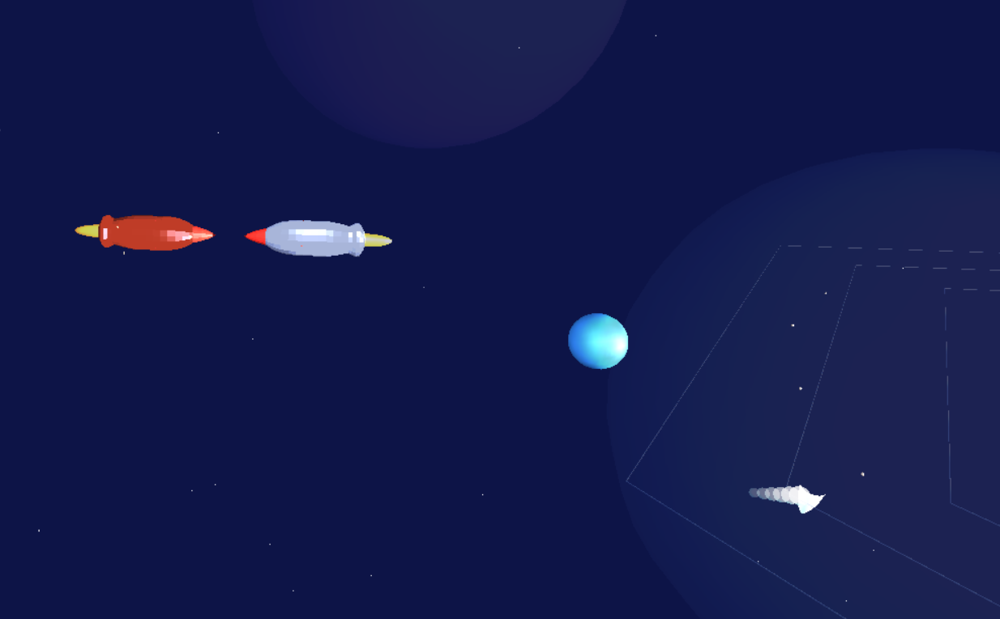
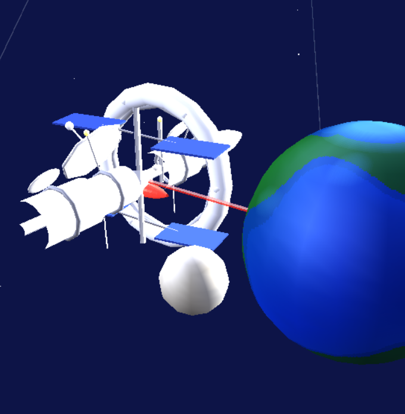
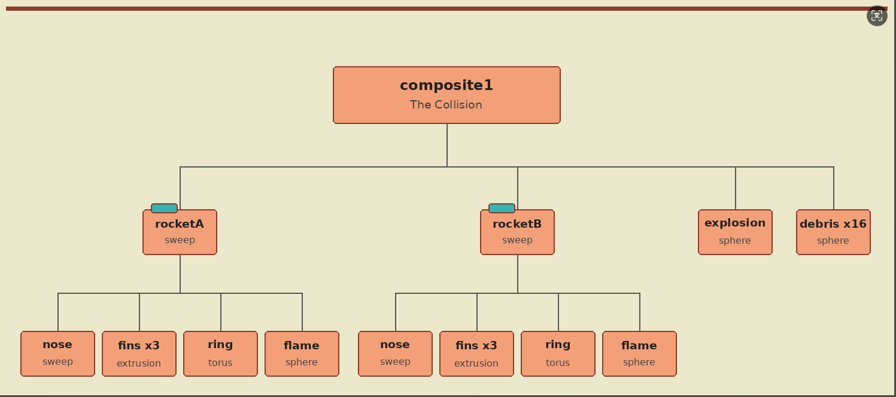
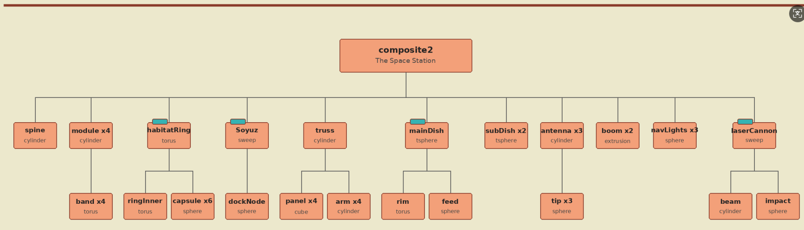

# Space Scene: Animated 3D Scene in C++ and OpenGL


An animated 3D space story built for a Computer Graphics course. Two rockets fly toward each other and collide in an explosion, while a huge textured sun, seven orbiting planets, an asteroid belt, a probe, and a comet fill the solar system. A space station orbits a blue Earth and fires a red laser at it when the camera zooms in.

## Screenshots





## Highlights

- **Two hierarchical composite objects**, each built from parented primitives and animated through its own class methods
- **Sweeps, extrusions, textures, and transparency** used for the rockets, the station, the laser, and the explosion
- **700 twinkling stars** and **faint nebula clouds** for depth
- **Six coloured lights with specular highlights** and realistic materials (brushed metal, glossy dishes, icy comet)
- **Cinematic camera** that blends eight key positions with smoothstep easing, then locks on and tracks the Earth and the station
- **Sound:** looping ambient music, a solar flare effect, and a crash boom at the moment of impact

## Composite 1: The Collision

Two rockets (sweep hulls with red nose cones, extruded fins, trim rings, and flickering flames) roll about their axes and fly toward each other. On impact, a transparent explosion grows and fades while sixteen rocky debris pieces burst outward.



- **Rockets and flames:** roll while flying in, flames flicker (`animateRockets()`)
- **Explosion:** grows then fades once at impact (`animateExplosion()`)
- **Debris:** bursts outward, tumbling and fading (`animateDebris()`)

The whole sequence is driven by `runSequence()`.

## Composite 2: The Space Station

A station with a central hub, long spine, four modules, a rotating habitat ring, a Soyuz-style capsule, four solar arrays, scanning dishes, sweeping antennas, blinking navigation lights, and an Earth-facing laser cannon. It orbits the Earth on an inclined path and always stays Earth-pointing.



- **Whole station:** orbits the Earth, staying Earth-pointing (`animateStation()`)
- **Habitat ring capsules:** rotate continuously around the ring (`animateHabitatRing()`)
- **Solar arrays:** gimbal to track the sun (`animateSolarPanels()`)
- **Dishes:** main dish and sub-dishes scan at different speeds (`animateDishes()`)
- **Antennas:** sweep gently with glowing tips (`animateAntennas()`)
- **Navigation lights:** blink in their own rhythm (`animateNavLights()`)
- **Laser:** powers up and flickers once the camera zooms in on the Earth (`animateLaser()`)

## Repository Contents

```
.
├── src/
│   ├── composite1.h / composite1.cpp   # The collision
│   ├── composite2.h / composite2.cpp   # The space station
│   └── scene.cpp                       # Scene setup, lights, camera, sound
├── resources/                          # Shape definitions for the sweeps and extrusions
│   ├── shipBody.txt                    # Rocket body profile
│   ├── aegisNose.txt                   # Nose cones, station capsule, laser cannon, comet
│   ├── wingProf.txt / wingPath.txt     # Fins and instrument booms
│   └── orbitRingProf.txt / orbitRingPath.txt   # Research probe
├── screenshots/
└── README.md
```

## Note on the Engine

This project was built on a graphics engine supplied by the course (the source headers credit Tony Gray as the original engine author), in which every primitive registers itself with a global draw list and is depth-sorted automatically. The engine, textures, and audio files are **not included** in this repository, so it cannot be compiled on its own. The files here are what I wrote on top of that engine: the two composite objects, the scene that brings everything together, and the shape-definition files used by the sweeps and extrusions.

## Skills Demonstrated

C++ · OpenGL · 3D modeling from primitives (sweeps and extrusions) · Scene hierarchies and parent/child transforms · Animation · Lighting and materials · Transparency and depth sorting · Camera motion · Audio integration · Technical documentation

## Author

**Mohammed Al-Zubair**
[github.com/Mohammed-Alzubair](https://github.com/Mohammed-Alzubair)
